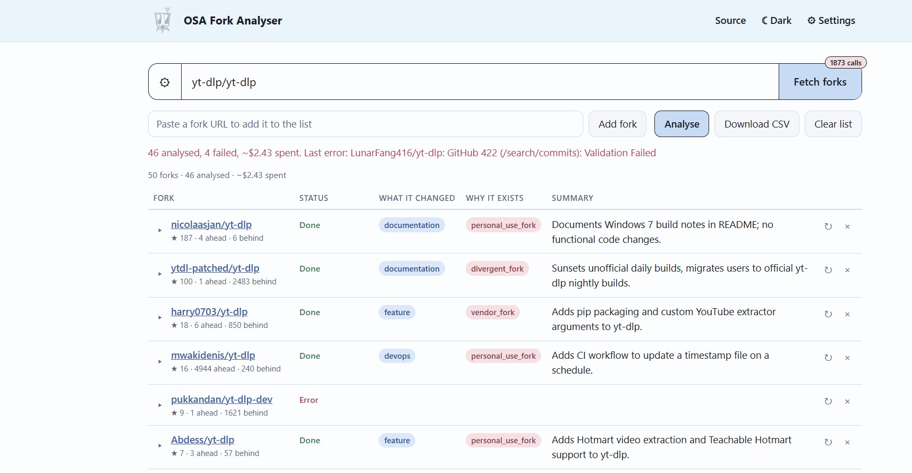
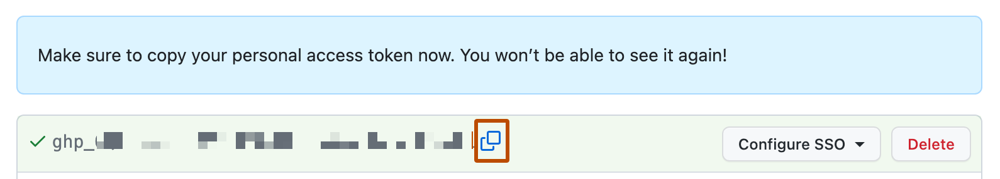

# about this project

OSA (Fork Analyser) has one goal: to make it a hundred times easier for developers to navigate GitHub forks.

For over a decade, the github fork system has been extremely cumbersome to use.
OSA generates AI summaries and tags them based on.

This is my first time starting an open source project, so things might be a bit rough at first, but if you have any suggestions on how to improve the project or would like to contribute, I gladly welcome you ❤️



# how to use?

Step 1! - [go to the github pages!](https://whatsacloud.github.io/osa-fork-analyser/)
Step 2! - get a GitHub token and paste it into Settings
Step 3! - get an OpenAI API key and paste it into Settings

Both keys stay in your browser's `localStorage` — they're sent only to `api.github.com` and
`api.openai.com`, never anywhere else. See the sections below for exactly where to get each one.

## Getting a GitHub token

OSA needs a GitHub token to fetch forks, diffs, commits and PRs at a reasonable rate limit
(unauthenticated requests are capped at 60/hour and will stall on anything but a small repo).
A **fine-grained token with read-only access to public repositories** is the recommended option
— it can't read private repos or write anything, even if it leaked.

1. Click your profile picture (top right of any GitHub page) → **Settings**.
2. In the left sidebar, click **Developer settings**.
3. In the left sidebar, under **Personal access tokens**, click **Fine-grained tokens**.
4. Click **Generate new token**.
5. Give it a name, leave the expiration at its default, and under **Repository access** choose
   **Public Repositories (read-only)**. No other permissions are needed.
6. Click **Generate token**.
7. Copy it immediately — GitHub only shows it once, with a reminder like this:

   

   *(from [GitHub's own docs](https://docs.github.com/en/authentication/keeping-your-account-and-data-secure/managing-your-personal-access-tokens) on personal access tokens)*
8. Paste it into OSA's Settings dialog (gear icon, top bar) under **GitHub token**.

A classic token with **no scopes selected** also works (it still gets the higher authenticated
rate limit for public data) if you'd rather not deal with fine-grained permissions. Full
step-by-step instructions, including screenshots of each settings page, are in
[GitHub's own docs](https://docs.github.com/en/authentication/keeping-your-account-and-data-secure/managing-your-personal-access-tokens#creating-a-fine-grained-personal-access-token).

## Getting an OpenAI API key

The OpenAI key is only used for **Analyse** — fetching and listing forks works without one.
You'll need an OpenAI account with a payment method on file; with the default model (`gpt-4.1`)
analysing a fork typically costs a few cents, more for forks with very large diffs.

1. Sign in at [platform.openai.com](https://platform.openai.com).
2. Open **API keys** from the left sidebar (under your project/organisation).
3. Click **+ Create new secret key**, optionally give it a name, and confirm.
4. Copy the key immediately — like GitHub, OpenAI only shows the full secret once; if you miss
   it, delete that key and generate a new one.
5. Paste it into OSA's Settings dialog under **OpenAI API key**.

If you've never used the API before, you may also need to add a payment method under
**Settings → Billing** before the key can make requests. See
[OpenAI's help article on finding your API key](https://help.openai.com/en/articles/4936850-where-do-i-find-my-openai-api-key)
for more.

# Disclaimers
1. while the current codebase is created and refactored with Claude Code, it was originally handwritten
2. the current website design is heavily inspired by [useful forks](https://useful-forks.github.io/)

# NEXT PROJECT GOALS

1. "find a feature across 1000 forks"
	1. dynamic tagging (eg if yt-dlp repo supports "Hotmart", it tags it as "Hotmart")
	2. peer-to-peer decentralized fork database (cache and pool fork queries across all users to gradually build a full database of the fork ecosystem)
2. Expand fork analyser
	1. massive forks (forks with such a massive diff it can't be loaded fully)
	2. informal forks (forks with no shared commit history (branched off)

micro tasks
make error messages more descriptive

# References
Useful-forks
INFOX

# OSA Fork Analyser

Find the forks of a GitHub repository that did real work, then classify what each fork
changed and why it exists.

1. Enter a repository (`owner/repo` or its URL) and press **Fetch forks**. You get up to 50
   of its most-starred forks that have commits ahead of upstream. Forks never pushed to after
   being created are skipped.
2. Optionally paste any fork's URL into the second box to add it to the list.
3. Press **Analyse**. Forks are queued and analysed a few at a time (adjustable in Settings).
   For each fork, the app reads its diff, commits, PRs and related repos from GitHub, asks an
   LLM to describe what it sees, and runs fixed rules over that description to pick two labels
   (see **Methodology** below).
4. Press **Download CSV** to export the list and results.

It is a static site with no backend. Your GitHub token and OpenAI key are stored in your
browser's localStorage and sent only to `api.github.com` and `api.openai.com`. Results are
cached in localStorage, so re-opening a repository does not pay for the same analysis twice.

## Methodology

**Long story short:** OSA looks at what a fork's code actually changed, has an AI tick off a
checklist of plain true/false facts about it (never an opinion), then runs fixed if-this-then-
that rules over that checklist to pick two tags — **what kind of change it was** (a feature? a
bugfix? just docs?) and **why the fork probably exists** (sending work back upstream? its own
spin-off product? one person's personal tweaks?). The AI never picks the tags itself, so the
same evidence always lands on the same tag. (theoretically)

**Long story:** OSA never asks the LLM to pick a label. For each fork it gathers evidence from GitHub (the
diff against upstream, commit messages, PRs the fork has open or merged against upstream,
whether the fork is consumed elsewhere as a submodule, whether its owner is a user or an
organisation, and more — see `fetchForkData`), then asks the LLM to report a fixed list of
true/false **signals** about that evidence (`prompts/extract.prompt`, `signals.js`) — things
like "adds functionality", "fixes an explicitly-stated bug", "only touches CI config", "is a
translation". A separate, deterministic rule table (`categoriser.js`) turns those signals into
exactly two labels per fork. This split keeps the LLM's job to *observation*, so the same
evidence always produces the same label, and the rules can be tuned or tested without touching
the LLM prompt.

Each label comes from a small table of rules of the shape *"if signal X (and not signal Y), vote
for label Z with strength S"*. Every rule in the table is evaluated; the label with the
strongest vote wins; a tie is broken by which rule was more specific, then by table order.
Some signals are written to actively cancel another label out (e.g. a build fix cancels out a
plain **bugfix**), so a fork never gets double-counted into two overlapping buckets.

### What it changed (engineering label)

| Label | What makes it win |
|---|---|
| `system_port` | Explicitly ports to a new OS, CPU architecture, or virtual target (WASM, ARM, iOS, …). Outranks everything else — a port that happens to add a build tool is still a port. |
| `documentation` | Meaningful (non-cosmetic) documentation changes, and nothing semantically bigger. |
| `translation` | Translates code comments, docs, or UI strings into another language. |
| `meaningless` | Every change has zero functional effect — whitespace, comment reflow, import reordering. Also the fallback when no other rule fires. |
| `optimisation` | Explicitly targets speed or memory efficiency. |
| `bugfix` | A bug fix the author *explicitly* states as such (never inferred from the diff alone). A fix for a **compilation** error is re-routed to `build` instead, since it's tooling, not runtime behaviour. |
| `feature` | Adds or removes user-facing functionality. Functionality that arrived purely by merging upstream changes doesn't count — only the fork author's own additions do. |
| `build` | Introduces or substantially changes a build tool (CMake, Meson, Bazel, …) not present upstream. Deferred to `system_port` if that tool exists to support a port, and to `devops` if it's actually just CI config. |
| `devops` | All meaningful changes are confined to CI/CD pipeline files. |
| `package_registry_upload` | Fork adds packaging metadata to publish itself to a registry (npm, Cargo, Debian, …). |

Labels are grouped by priority ("level"): a `system_port`/`documentation`/`translation`/
`meaningless` verdict always beats `optimisation`, which always beats `bugfix`/`feature`, which
always beats `build`/`devops`/`package_registry_upload`. Within the same priority, the rule
with the strongest evidence wins.

### Why it exists (upstream-relationship label)

| Label | What makes it win |
|---|---|
| `contributing_fork` | The fork exists mainly to send work upstream — it has commits or PRs targeting the original repo, **and** nothing outside those PRs. One commit the fork keeps to itself disqualifies it immediately, since the fork has then grown beyond "just contributing". |
| `vendor_fork` | The fork packages or redistributes the project (a translation, a registry upload) or is itself consumed elsewhere — referenced as a git submodule, or identifiable as a dependency of other repos. |
| `academic_fork` | The fork's author is identifiably tied to a university, lab, or academic project. |
| `divergent_fork` | The fork has rebranded as its own product (its own name, its own README/install instructions) rather than staying a variant of upstream. An organisation-owned fork gets extra weight here, since orgs rarely fork just to poke around. |
| `personal_use_fork` | The default when nothing else distinguishes the fork — one person's local tweaks with no onward story. Organisation ownership actively argues against this label. |

Unlike the engineering label, every upstream rule carries the same priority, so the strongest
single piece of evidence decides — except `contributing_fork` and the "is this a vendor/
translation repo" check, which are absolute: once either is unambiguously true (or false), no
amount of other evidence can override it.

## Running locally

ES modules don't load from `file://`, so serve the folder over HTTP. Either:

```sh
python -m http.server 8000
```

or, with Node 20+:

```sh
npm start
```

Then open http://localhost:8000. There is nothing to install and no build step.

You need:

- a **GitHub token**: a classic token with no scopes, or a fine-grained token with read-only
  access to public repositories (see **Getting a GitHub token** above);
- an **OpenAI API key** (only for Analyse, see **Getting an OpenAI API key** above). With the
  default model (`gpt-4.1`) a fork typically costs a few cents, more for forks with very large
  diffs.

## Project layout

```
index.html                 page markup
css/styles.css             all styles (light + dark tokens at the top)
assets/                    the osa mascot: original drawing, logo, favicon, intro image
assets/docs/               screenshots used in this README
prompts/extract.prompt     the LLM prompt: edit this to change what gets observed
js/
  main.js                  app state and the button handlers (fetch, add, analyse, CSV)
  config.js                limits, model and pricing constants
  queue.js                 concurrency helper used everywhere
  store.js                 everything that touches localStorage
  csv.js                   CSV export
  dom.js                   tiny safe element builder
  github/
    client.js              REST + GraphQL wrapper, rate-limit handling
    forks.js               finding forks that are ahead of upstream; looking up one fork
    forkData.js            everything gathered about a fork before analysis
    queries.js             GraphQL queries
    repo.js                parsing "owner/repo" and GitHub URLs
  analysis/
    analyse.js             the per-fork pipeline: GitHub data → LLM → labels
    llm.js                 OpenAI call and response parsing
    signals.js             the list of boolean signals the LLM reports
    categoriser.js         the labelling rules
  ui/
    forkTable.js           the results table
    settings.js            the settings dialog
    theme.js               light/dark toggle
tests/                     node --test unit tests
```

See [CONTRIBUTING.md](CONTRIBUTING.md) for how to change the rules, the prompt or the UI.

## License

Apache 2.0, see [LICENSE](LICENSE).
